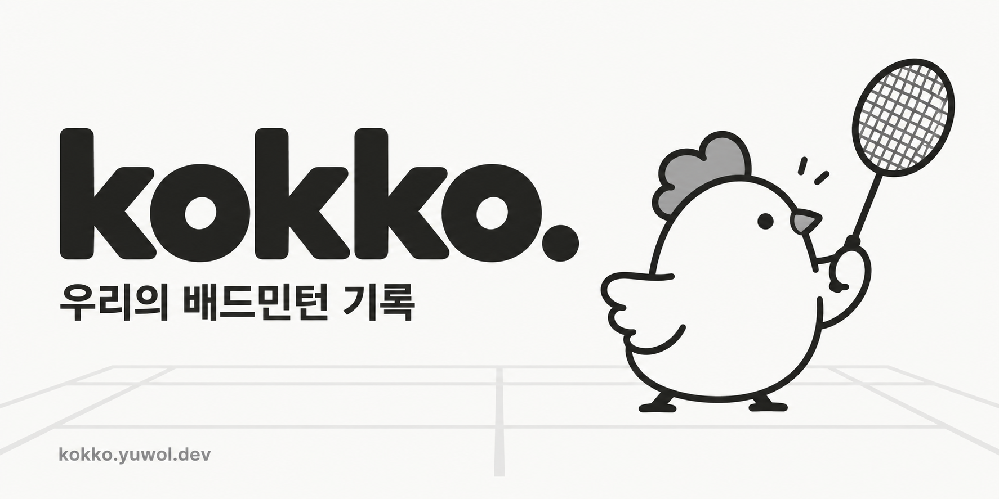

# kokko

A mobile-first badminton community with global singles/doubles Elo, public match history, mutual friends and quick match entry. Any active registered players can play together. A new result affects rankings after **one opposing player confirms** it.

**v2.0 public model:** the owner approved publication of existing match details and replaced private groups with player discovery and friends. [The public contract](docs/PUBLIC.md) defines visibility, confirmation and migration. Google/Kakao signup remains controlled by `KOKKO_PUBLIC_SIGNUP` (default `false`) until real provider callbacks and launch checks in #14/#16 are complete. The [Pi assessment](docs/plans/2026-11-18-public-platform.md) still applies to the roughly 100-DAU pilot.

The application interface is in Korean. **꼬꼬** is the chicken mascot holding a badminton racket.



## Joining the project

New contributors and coding agents should start with the [portable project handoff](docs/HANDOFF.md) and [agent workflow](AGENTS.md). The [decision record](docs/DECISIONS.md) explains the architecture and product choices; the [conversation archive](docs/history/2026-10-31-conversation.md) preserves the available user requests and implementation history. These versioned files travel with the repository and require no access to the original chat or workstation.

## Features

- **Today's Court:** choose attending friends, see today's game counts, and get fair doubles suggestions that open directly in match entry.
- **Quick match entry:** singles or doubles, player selection, one-tap doubles pairings, numeric scores, and same-player or rotated-team next matches.
- **Reliable saving:** preserve entries after a failed submission and retry without creating duplicates. Genuine repeated games are allowed.
- **Match history:** filter by player, match type, period, and result; inspect individual rating changes.
- **Confirmed results:** an opposing player approves new games and corrections. Pending changes preserve the accepted result. Approval replays affected ratings atomically.
- **Player statistics:** separate singles/doubles rankings, rating charts, win rates, partner statistics, and head-to-head results.
- **Friends and discovery:** request/accept friends, prioritize them in quick entry and attendance, or search any active player by nickname/#handle. Friendship is optional for matches.
- **Public profiles and moderation:** exact statistics, charts and activity; edit your own name/photo. Service administrators rename members and review private reports or void invalid results with a reason.

## Recording games

One completed game is one match record. Doubles is selected by default, with the signed-in player preselected.

After selecting four players, **Quick team combinations (빠른 팀 조합)** shows all three possible doubles pairings. Tap a different pairing to reassign the teams and clear both scores. The current pairing stays selected even when you swap team sides. After saving, keep the same teams or tap either alternate pairing to start the next game immediately, preserving the playing date and appending to that day's games. The selected doubles lineup is remembered for that playing date in the current browser tab, including after leaving the entry screen; sign-out clears it. Singles entry does not show doubles rotation controls.

A valid result is:

- **21–0 through 21–19** for a normal game.
- **22–20 through 29–27** for a two-point win after deuce.
- **30–28 or 30–29** at the 30-point cap.

The same rules apply whichever team wins. Ties, unfinished games, negative scores, and fractional scores are rejected.

For faster score entry, enter the losing team's score and tap the winning team's **“N-point win” (N점 승리)** button. It fills 21 for ordinary results, the two-point winning score after deuce, or 30 against 28/29. With the other score blank it fills 21 and leaves that field blank. The shortcut is unavailable against an opponent score of 30 or an invalid score. Both scores remain directly editable; changing one does not automatically change the other. The shortcuts also work when correcting a match, and saving still requires a complete, valid result.

Open **예상 승률 미리보기** below the selected teams for optional predictions while keeping final scores close to the team controls. It uses current singles Elo for singles and mean teammate doubles Elo for doubles, with the same expected-result formula as rating calculations and Today's Court. Swap sides, choose another pairing, or change players to compare the estimates. Players without records in that discipline use 1,000 Elo, with a visible notice. Incomplete or duplicate lineups show a selection prompt. Percentages are rounded together; extreme estimates say “under 1%” or “over 99%.” These are descriptive current-Elo estimates, including on historical entries and corrections, rather than reconstructed pre-match predictions. Scores and dates do not affect the preview, and previewing never changes records or Elo.

The preview also shows **personal Elo changes for a win and loss**, to one decimal place, plus rating deviation (RD). Glicko uses each player’s uncertainty, so doubles teammates can receive different changes. Lower RD means a more certain rating. These outcomes describe playing that matchup now; historical corrections still recalculate the real rating history on the server.

### Try an imaginary matchup

Open **가상 대결** in the compact tool row below recent matches on Home, or **가상 대결에서 미리 비교하기** from match entry. At `/simulate`, select any active players, including lineups without yourself, to see their current win percentages and win/loss Elo adjustments. Select an already chosen player to swap positions, swap team sides, or try another doubles pairing. Both simulation and real match entry use the same avatar-based participant picker. Tap a slot to open the active-member dialog, select an already chosen member to swap positions, or tap **선택 해제** to clear the slot. The simulator has no score entry or save action; it leaves real match drafts, unresolved saves, attendance, and lineup memory untouched. Its selections reset when the screen is reloaded or left.

### Plan the next game

Open **“Suggest the next game” (다음 경기 추천)** in the compact tool row below recent matches on Home, or **“Get the next match suggestion” (다음 경기 추천받기)** after saving. In **Today's Court (오늘의 코트)**, select the friends who are present. The signed-in player stays included so the suggested game can be recorded by a participant. Attendance is remembered per member and Korean calendar date in the current browser tab and cleared on sign-out.

Up to three suggestions for at most 12 attending players prioritize game counts (including singles and pending new games you participate in), then who played longest ago. Within those priorities, use current doubles Elo to group team balance into five-percentage-point bands around a 50% expected result, prefer fewer repeated partnerships within the day, then break ties by exact balance and stable player IDs. New players use 1,000 Elo. Deleted and other-day matches do not count toward today's turns or partnership repetition. Changing the attendance selection does not alter records or ratings.

Tap a suggestion to fill the four player slots with today's date and empty scores. An existing scored draft requires an explicit choice before replacement. A game awaiting a save response must be revisited and resolved before a suggestion can replace it. The server still validates participants and match results when saving.

Dates use **Asia/Seoul**. Historical dates are allowed; future dates are not. Games share a within-day sequence across singles and doubles, so no exact playing time is required. New games go last unless a position is selected. Use the history screen to inspect the day's sequence and the match edit screen to correct it.

Only a participant may report a game or propose a correction, withdrawal or restoration. One active player on the opposing team must confirm; neither teammates nor administrators can bypass that rule. Existing published records are already accepted. Pending requests are private to participants in **확인함**, do not affect Elo, and can be rejected by the opponent or cancelled by their author.

Corrections retain the accepted players/teams and original authorship. Report a wrong lineup from match details. Administrators can exclude invalid results immediately with a reason, closing outstanding proposals. An administrator must review that exclusion before participants can request a separately confirmed restoration. Find your withdrawn games in **설정 → 제외된 경기**.

## Public players and friends

The Home dashboard has global singles/doubles standings and a **친구와 나** filter that retains global ordinal positions. A profile is unranked until its first accepted game. Nicknames, uploaded avatars, #handles and accepted match/date/lineup/score/rating details are public, including pre-v2 history as authorized by the owner. Authentication emails, provider identities, other users' roles, reports, retries and raw audits are private. A displayed #handle disambiguates equal nicknames.

Use **친구** to request/accept a relationship. Friends appear first in quick selection and can be added to today's temporary roster. Search can add any active unblocked player, even without a friendship or a former group membership. Blocking removes the relationship and prevents new shared lineups/requests; past records stay intact. Old group tables and operator APIs remain only for compatibility/recovery, with no group selector or public creation/join flow.

History uses 25-game pages; profiles calculate exact totals and 365-day/all-time activity independently. Charts show the most recent 200 filtered games with a visible truncation label; partner/opponent summaries show the 50 most frequent. Explicit day placement is offered for up to 1,000 accepted games/day. Older browser drafts remain on the device; group-scoped drafts can be imported from entry and ambiguous pre-upgrade saves are resolved through the original request before conversion.

Read [PUBLIC.md](docs/PUBLIC.md) and [IDENTITY.md](docs/IDENTITY.md). Keep `KOKKO_PUBLIC_SIGNUP=false` until the coordinated launch checks are complete. Back up with v1.10.0 and rehearse restoration/migration before upgrade. Recovery requires the old archive and image; publication of v2 is an intentional access-policy change, not a rating reset.

## How Elo works

Ratings now use **Glicko-1**, the confidence-aware system described by Chess.com. Every player starts at **1,000 / RD 350**, separately for singles and doubles. More games reduce rating deviation (RD); inactivity raises RD without lowering the rating itself. Your own confidence and the other players’ confidence affect the adjustment. Score margin does not affect it.

Doubles uses mean team strength with an explicitly documented individual-contribution adapter. Teammates can receive different changes and ratings are not zero-sum. With everyone new, an equal-rating first game changes each singles player by approximately ±162.2, or each doubles player by ±112.3. These are kokko settings, not a claim to reproduce Chess.com’s private implementation.

See [the rating contract, equations, settings, and migration](docs/RATINGS.md). Predictions and simulation use current ratings and RD, with a separate conditional change for each player. Open **레이팅 신뢰도 안내** on Home or a player profile to understand RD.

The server replays recorded matches in playing order without intermediate rounding. Current ratings display as integers; changes display to one decimal place. Rankings share positions for equal displayed ratings; players without games are unranked. Corrections replay both rating and confidence history.

**v1.8.0 deployment:** take a pre-upgrade backup with the previous image before starting the new image. Startup automatically adds RD fields and atomically recalculates both disciplines from existing matches once. No new environment variables are needed. To rehearse against a stopped, isolated data copy, run `kokko ratings`, then `kokko ratings --apply`, and preview again. Downgrading requires restoring the previous backup as well as the old image.

### Rank tiers and crests

Home, player profiles, and player standings show six ranks with original colored badminton crests: copper Bronze, cool-steel Silver, yellow-gold Gold, emerald Platinum, blue Diamond, and violet Master. Crests stay compact: 64px on tier cards, 56px in the guide, and 24px beside the tier name in standings. Singles and doubles have independent tiers, based on the **displayed, rounded current Elo** in that discipline. A player must have at least one current, non-deleted game in that pool; otherwise the tier is **미배정**. Period filters do not change a cumulative tier.

| Tier | Displayed Elo |
| --- | --- |
| 브론즈 | Below 900 |
| 실버 | 900–999 |
| 골드 | 1,000–1,099 |
| 플래티넘 | 1,100–1,199 |
| 다이아몬드 | 1,200–1,299 |
| 마스터 | 1,300 and above |

Tier cards show the exact displayed-Elo distance to the next tier. Progress bars cover the final 100 Elo before promotion, clamped at zero for a longer distance; Master has no further target. Changes to current ratings, including historical replay, can promote or demote a tier. These are derived display tiers, not persisted awards or a new Elo calculation. Standings continue to use server-assigned ordinal positions, including ties; inactive and zero-game members have no position. Open **티어 기준** for the crest gallery and rules.

The six crests are delivered as optimized transparent WebP assets. See [crest artwork and generation prompts](docs/CRESTS.md) for the delivered files and built-in image_gen provenance.

Inserting, editing, reordering, deleting, or restoring an old match replays the affected rating pool from the beginning. Accepted lineups/disciplines are immutable to participant corrections. Later rating changes can therefore change after a historical correction. Match changes and recalculation commit together; readers never receive a partially recalculated snapshot.

### Profile activity streaks

Player profiles include a monochrome contribution-style calendar for the latest 365 Korean calendar days. Both singles and doubles count, regardless of win/loss or profile filters. A day with one or more non-deleted games is active; additional games darken its square. Tap a square, use arrow keys, or choose a date to see the exact count.

The current streak counts consecutive active dates ending today or yesterday, allowing today to finish before a streak breaks. Longest streak uses all recorded history; active days and the calendar game total cover only the visible 365 days. Played dates determine activity, including backdated entries. Corrections, deletions, and restorations update activity with the next server snapshot. No migration or new settings are needed.

## Period statistics and partner synergy

The 7-, 30-, and 90-day filters include today and the preceding N−1 Korean calendar dates. An all-time option is also available.

**Period Elo change = sum of the player’s accepted match rating deltas in the selected period.** The starting baseline is 1,000 if no earlier games exist. A period with no games shows zero games and zero change. Charts show global Elo at the player's game times, starting before the displayed interval, with separate points even on the same day. Rankings remain cumulative regardless of the selected period.

Doubles partner synergy measures performance relative to the opponents faced:

```text
Synergy = 100 × mean(actual result − pre-match expected win probability)
```

The unit is **percentage points (pp)**. Winning 60% of games when the average expected win probability was 50% gives +10 pp. Expected probabilities come from the full-history pre-match Elo, while the sample includes only games in the selected period.

Fewer than **five games with a partner in that period** shows “insufficient data.” Win rate and sample size are displayed separately. Synergy is a descriptive reference, not proof that a partnership causes better results.

## Accounts and privacy

- Google/Kakao create an identity with a user-chosen public nickname when signup is enabled. No invitation or group is required. While signup is disabled, existing active members can log in; new visitors can read public results and see a preparing-signup screen.
- **설정 → 로그인 계정 연결** explicitly links another provider to the same account. Matching email never merges accounts. Provider tokens/metadata remain server-side.
- Members edit their nickname/photo. Active service administrators rename others at **설정 → 서비스 관리 → 회원 닉네임**, including suspended profiles, without changing IDs, photos, privileges or history. Names contain 1–20 Unicode characters after trimming. PocketBase `users.name` is separate from the public profile.
- Suspension blocks authenticated actions and new participation. Historical public results remain visible. Account erasure/recovery UX and automated off-host backups remain tracked launch work; no offline synchronization is provided.
- Use one PocketBase/SQLite process and one server instance. Keep the persistent encryption key and original data volume.

## Local development

Required tools: **Node.js 24**, **pnpm 12.5.1**, and **Go 1.27.2**. PocketBase is pinned to **0.40.5** in the Go module.

`pnpm test` runs Go's race detector, which requires cgo and a working C compiler with development headers (for example, `build-essential` on Debian/Ubuntu). Keep `CGO_ENABLED=1` for these tests; a Go-only toolchain cannot run them.

From the repository root:

```sh
corepack enable
corepack prepare pnpm@12.5.1 --activate
pnpm install --frozen-lockfile
cp .env.example .env
```

Fill in the Google credentials in `.env` using the setup below. Load them into the backend's environment and start it:

```sh
set -a
source .env
set +a
pnpm dev:server
```

In a second terminal, run `pnpm dev`, then open **http://localhost:5173**. Vite proxies `/api` to the backend on port 8090. Local data is stored in `apps/server/pb_data` and excluded from Git. Compose loads `.env` automatically; the local Go process does not.

## Google OAuth setup

Create a **Web application** OAuth client in Google Cloud and configure its consent screen. If the client is in testing mode, add the group's accounts as test users.

| Environment | Authorized JavaScript origin | Authorized redirect URI |
| --- | --- | --- |
| Development | `http://localhost:5173` | `http://localhost:5173/auth/callback` |
| Production | `https://kokko.yuwol.dev` | `https://kokko.yuwol.dev/auth/callback` |

Set `GOOGLE_CLIENT_ID` and `GOOGLE_CLIENT_SECRET` in `.env`. The secret stays on the server. Login uses a same-tab authorization-code flow with state and PKCE; register the callback above rather than PocketBase's default popup callback.

Without these credentials, only Google authentication is disabled. Configure Kakao independently using `KAKAO_CLIENT_ID` (REST API key) and `KAKAO_CLIENT_SECRET`, register the same callback, and enable nickname consent. Read [the complete Google/Kakao setup and linking guide](docs/IDENTITY.md). Automated callbacks use synthetic providers and do not verify live Google or Kakao sign-in.

`KOKKO_PUBLIC_SIGNUP` defaults to `false`. Leave it off on production until the public group and launch phases are complete; `true` enables nickname onboarding on isolated staging. Changing this switch never admits a user into the existing private group.

## Deployment

The Go server serves both the built frontend and API. Docker builds use digest-pinned **Docker Hardened Images (`dhi.io`)** for Node, Go, and the static runtime. Prepare Docker with Compose and registry access (`docker login dhi.io` if required).

Before starting production:

1. Configure the intended Google/Kakao providers and `.env`; keep public signup disabled until the coordinated rollout is ready.
2. Generate `PB_ENCRYPTION_KEY` with `openssl rand -hex 16` and put the resulting 32-character key in `.env`. Keep it stable and back it up separately; it is needed for recovery.
3. Point `kokko.yuwol.dev` at your host and configure TLS and network access for your chosen topology below.
4. Arrange a separate destination for backup copies.

### With your own reverse proxy

nginx is managed outside this project. When it terminates HTTPS on the same host, **replace** `app.command` and `app.ports` in `compose.yaml` with:

```yaml
    command:
      - serve
      - --http=0.0.0.0:8080
      - --origins=https://kokko.yuwol.dev
    ports:
      - "127.0.0.1:8080:8080"
```

Keep `KOKKO_PUBLIC_URL=https://kokko.yuwol.dev`. Proxy all paths to `http://127.0.0.1:8080`, preserving the host and forwarding the original scheme and client IP. The proxy owns certificates and the HTTP-to-HTTPS redirect. The Google callback does not change.

If nginx also runs in Docker, use a shared private network and a container DNS name instead of `127.0.0.1`; no published backend port is needed in that arrangement.

The current server does not configure trusted proxy headers. To use the real client IP for rate limiting, add the following before `app.Save(settings)` in `apps/server/main.go` and rebuild:

```go
settings.TrustedProxy.Headers = []string{"X-Real-IP"}
settings.TrustedProxy.UseLeftmostIP = false
```

Use this only when the proxy overwrites `X-Real-IP` with the actual client address and clients cannot reach the backend directly. Otherwise, all users behind the proxy share its IP-based request limits.

### Direct HTTPS

The checked-in Compose file defaults to PocketBase-managed HTTPS. If you use it unchanged, allow external TCP 80/443 to reach the host; they map to container ports 8080/8443. PocketBase obtains and renews the certificate. DNS and both ports must be ready, and no other service may occupy them.

### Start and check

```sh
docker compose config --quiet
docker compose up --build -d
docker compose logs --tail=100 app
docker compose ps
curl --fail https://kokko.yuwol.dev/api/health
```

The container runs as UID/GID 65532 with a read-only root filesystem and persistent data under `/data/pb_data` in the `kokko_data` volume. **Do not run `docker compose down -v` unless you intend to delete that data.** Run a single app instance; do not scale multiple processes against the same database.

The healthcheck checks process availability, not public TLS configuration. Verify the public HTTPS endpoint separately. Container builds have been checked for Linux AMD64 and ARM64. Startup and backup/restore were verified on ARM64; verify runtime behavior on your deployment host.

| Variable | Purpose |
| --- | --- |
| `GOOGLE_CLIENT_ID`, `GOOGLE_CLIENT_SECRET` | Server-side Google OAuth credentials |
| `PB_ENCRYPTION_KEY` | Persistent settings-encryption key; required by Compose |
| `KOKKO_PUBLIC_URL` | Public origin; set by Compose |
| `KOKKO_DATA_DIR` | Data directory; `/data/pb_data` in the image |
| `KOKKO_PUBLIC_DIR` | Built frontend directory; `/app/public` in the image |
| `KOKKO_HEALTH_URL` | Optional health probe URL; defaults to internal HTTP port 8080 |

## Continuous integration and GHCR images

[The GitHub Actions workflow](.github/workflows/ci.yaml) runs on pull requests, pushes to `main`, candidate version tags matching `v*` or `[0-9]*`, and manual dispatches.

Every run checks Biome formatting/lint, TypeScript, `gofmt`, and `go vet`; runs frontend tests and Go tests with race detection; builds the app; and runs the mobile Chromium E2E suite. Failed browser runs upload diagnostic artifacts for seven days. No Google credentials or production database are needed for CI.

Release-tag validation and note extraction are also tested. The `pnpm release` command requires a matching dated entry in the committed [CHANGELOG.md](CHANGELOG.md), checks that the checkout matches `origin/main`, waits for passing main CI, creates the tag through `gh`, waits for successful image publication, then publishes a GitHub Release using that entry. Pre-release tags produce pre-releases. The command can resume an incomplete release on the same commit, preserving an already published release.

Only a **push of a valid semantic version tag**, after all checks pass, publishes a multi-platform image (`linux/amd64` and `linux/arm64`). Both `v1.2.3` and `1.2.3` are accepted, including pre-release and build-metadata suffixes defined by [SemVer 2.0.0](https://semver.org/). Tags such as `v1`, `v1.2`, `v01.2.3`, or `v1.2.3-01` do not publish. Pushes to `main`, pull requests, and manual dispatches run validation only, even if a manual dispatch selects a version tag. Registry credentials are available only to the publication job. Actions are pinned to commit SHAs.

Configure these **repository Actions secrets** before the first publication:

| Secret | Value |
| --- | --- |
| `DHI_USERNAME` | Docker username, or organization name for an organization token |
| `DHI_TOKEN` | Docker access token with permission to pull the pinned `dhi.io` images |

Your workstation's Docker login is not available on GitHub runners. GHCR publishing uses the automatic `GITHUB_TOKEN` with job-scoped `packages: write`; no separate GHCR token is needed in Actions. Repository/organization policies must allow package publication. If the GHCR package already exists, grant this repository Actions access to it.

Docker builds run the frontend build and Go tests on the builder's native architecture (`BUILDPLATFORM`), then cross-compile the static Go executable for each target (`TARGETOS`/`TARGETARCH`). QEMU is not required. The Docker test step prints individual test results and has a five-minute timeout per test package; target compilation is a separate step. The native CI race tests and browser tests remain required before publication.

Images are published under **`ghcr.io/injoonh/kokko`** (the workflow lowercases the repository owner/name):

| Trigger | Image tags |
| --- | --- |
| Push a release tag such as `v1.0.0` | `v1.0.0`, `sha-<full-commit-sha>` |
| Push a pre-release tag such as `v1.1.0-rc.1` | `v1.1.0-rc.1`, `sha-<full-commit-sha>` |
| Push to `main`, pull request, or manual dispatch | No image published |

No `latest` or `main` image tag is created or updated. Git tag names are preserved as image tags, except that `+` in build metadata becomes `_` to meet Docker tag rules (for example, `v1.0.0+build.1` becomes `v1.0.0_build.1`). The workflow summary includes the published digest for reproducible deployments. Publishing an image does not restart or deploy to your server.

To publish a release from the intended commit:

```sh
pnpm release v1.2.0
```

Sync the checkout to the tested, merged `main` commit, and replace the example with a new semantic version. Add the matching changelog entry in the feature PR first. Authenticate `gh` for this repository; no additional workflow-editing scope is needed. Never reuse or move an existing version tag. Feature releases increment the minor version; fixes increment the patch version. The ongoing contributor workflow is recorded in [AGENTS.md](AGENTS.md).

To deploy a published image, replace `image: kokko:local` in `compose.yaml` with `image: ghcr.io/injoonh/kokko:v1.2.0` (using your published version or digest), then run:

```sh
docker compose pull app
docker compose up -d --no-build app
```

Keep your existing environment, persistent volume, and reverse-proxy settings. Before an upgrade, take a backup. New GHCR packages default to private: either make the package public or authenticate the deployment host with `docker login ghcr.io` using a personal access token (classic) with `read:packages` and access to the package. Never put registry tokens in Compose or commit them to the repository.

References: [GitHub container publishing](https://docs.github.com/en/actions/tutorials/publish-packages/publish-docker-images), [DHI authentication](https://docs.docker.com/dhi/how-to/use/).

## First administrator and operator commands

The first signup is **not** automatically an administrator. On a new deployment, configure/verify the login providers, enable onboarding only in the intended ready environment, then sign in as the intended operator and choose a nickname. Existing installations keep their administrators. Identify the account and promote it explicitly while the app is stopped:

```sh
docker compose stop app
docker compose run --rm app members
docker compose run --rm app promote USER_ID
docker compose up -d app
```

Replace `USER_ID` with the intended active account's ID from `members`. Administrators then use **설정 → 서비스 관리** for nicknames and private reports. The old `invite`, `group-create` and `group-member` commands remain recovery/compatibility tools; v2 has no invitation or private-group UI. Do not enable production signup just to test a provider callback; use isolated staging and the launch checklist first.

To rename another member, first build or deploy an image containing the `rename` command, then stop the app and use the member ID from `members`:

```sh
docker compose build app
docker compose stop app
docker compose run --rm app members
docker compose run --rm app rename USER_ID "New nickname"
docker compose up -d app
```

Replace `USER_ID` with the intended member's ID and quote nicknames containing spaces. Nicknames must contain 1–20 characters after trimming surrounding whitespace. The command changes only the public nickname, preserves the profile photo and match/rating history, and also works for suspended members who already have a profile. Refresh the website to see the new name. `members` lists current public nicknames, falling back to Google names for accounts that have not activated a profile. When deploying published images, pull the updated image instead of running the build step.

To suspend a member, stop the app, run `docker compose run --rm app suspend USER_ID`, and start it again. For local development, run the corresponding `go run . invite`, `go run . members`, `go run . promote USER_ID`, or `go run . rename USER_ID "New nickname"` command from `apps/server`, with the development server stopped and the same environment loaded.

PocketBase's `/_/` admin page is blocked whenever `KOKKO_PUBLIC_URL` is set. A kokko administrator is not a PocketBase superuser; a superuser account is not needed for normal operation. The local admin page at `http://localhost:8090/_/` is available when that variable is unset and requires a separate superuser account. Domain data uses custom SQL tables and is not editable through PocketBase's standard collection screens.

## Backups and recovery

Production runs in UTC. Scheduled ZIP backups run daily at **18:00 UTC / 03:00 KST**, retaining up to **30 scheduled backups**. Local backup archives are not included inside subsequent backup archives.

Backups on the same volume do not protect against host failure. Copy completed archives to separate storage and apply an external retention policy. For example, replace the destination below with your own backup location:

```sh
mkdir -p /YOUR/SEPARATE/BACKUP/LOCATION
cid=$(docker compose ps -q app)
docker cp "$cid:/data/pb_data/backups/." /YOUR/SEPARATE/BACKUP/LOCATION/
```

Store the encryption key separately. Settings encryption does not encrypt the entire database or ZIP archive.

For a manual backup:

```sh
docker compose stop app
docker compose run --rm app backup
docker compose up -d app
```

The command prints a filename such as `manual-YYYYMMDD-HHMMSS.zip`. To restore an archive already in `pb_data/backups`, first back up the current state, then:

```sh
docker compose stop app
docker compose run --rm app restore manual-YYYYMMDD-HHMMSS.zip --yes
docker compose up -d app
```

For an external archive, replace the restore command with:

```sh
docker compose run --rm -v /ABSOLUTE/PATH/snapshot.zip:/restore.zip:ro app restore /restore.zip --yes
```

Restore must run while the server is stopped. It replaces the data directory and retains the old one as `/data/pb_data.before-restore-TIMESTAMP`. Use trusted backup archives; unsafe paths and archives exceeding the 5 GiB extraction limit are rejected. Verify login, members, matches, playing order, and Elo before removing the retained directory.

## Development reference

The pnpm workspace contains `apps/web` (React, TypeScript, Vite, TanStack Router, Tailwind, shadcn/ui, and Recharts). `apps/server` has its own Go module for PocketBase extensions and migrations. Dependency versions are pinned in the package manifests and lockfiles.

```sh
pnpm format       # Biome and gofmt
pnpm check        # Biome, TypeScript, and go vet
pnpm test         # Frontend unit tests and Go tests with the race detector
pnpm build        # Production frontend and server binary

pnpm --filter @kokko/web exec playwright install chromium
pnpm test:e2e     # Run after pnpm build
```

Tests cover scoring, active-role/participant/opponent authorization, public field projection, friends/blocking, exact paginated aggregates, rating replay, concurrent confirmation, old/new retry safety, OAuth ownership and populated backup/migration recovery. Mobile browser tests use an isolated temporary PocketBase database on port 8097; their test-only authentication endpoint is excluded from the production binary.

Pending migrations run on server startup. Back up before upgrades; down migrations are destructive. Real Google login, public TLS, and off-host backup delivery must be verified in your deployment environment.

See [SPEC.md](SPEC.md) for the full product and engineering specification. The self-hosted Pretendard font includes its [OFL license](apps/web/public/fonts/LICENSE.txt); shadcn/ui components include their [MIT notice](apps/web/src/components/ui/LICENSE).
