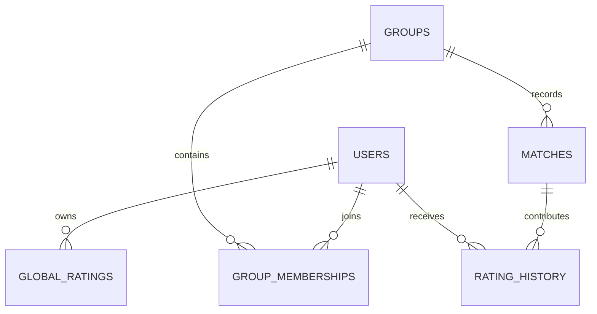

# Public platform: architecture and capacity assessment

> **2026-11-21 update:** the owner replaced self-service groups with global players, mutual friends and temporary court rosters, approved publication of existing match details, and chose confirmation by one opposing participant. [PUBLIC.md](../PUBLIC.md) and decision 21 supersede the group/privacy/confirmation proposals below. The PocketBase/Pi measurements and launch checks remain relevant; signup is still gated.

Assessment date: **2026-11-18**. Current source/deployment baseline: **v1.7.0**, one private group. This document records the approved product direction and an implementation plan; public signup, multiple groups, and a public leaderboard have not shipped through this assessment.

## Confirmed direction

The owner wants students at their school to use kokko, with about **100 daily active users** initially. They confirmed:

- Registration is open, without a school-domain or invitation-code requirement.
- Google and Kakao accounts are the intended login methods.
- Users can create groups and freely join open groups.
- Elo follows each person across groups. Preserve separate singles and doubles disciplines.
- A service-wide dashboard shows the highest-rated players.
- Inspect the existing host through `ssh raspberrypi` to assess capacity.

The primary product goal remains convenient recording of completed badminton games. The scope change supersedes the earlier private-ten-friends target for future development; existing releases still implement that earlier model.

## Recommendation

**Keep React, the Go-embedded PocketBase backend, and Docker Compose for the first public rollout. Keep the current Pi for the pilot, while improving storage, queries, and write behavior before public signup is enabled.** There is no demonstrated requirement for a different database, a distributed backend, or additional infrastructure at 100 DAU.

PocketBase is designed for small/midsize applications on one vertically scaled server and uses SQLite/WAL ([official FAQ](https://pocketbase.io/faq/)). It remains pre-1.0 with compatibility/maintenance considerations for critical production workloads ([official introduction](https://pocketbase.io/docs/)). Continue pinning the version, reviewing upgrades, testing migrations, and verifying recovery. A school hobby/community rollout is a reasonable fit; an institutionally guaranteed availability requirement would justify a separate hosting/backend decision.

The repository pins v0.40.5, while the online documentation displayed v0.42.3 during this assessment. Native Kakao support was checked against the pinned local module. Review upstream changes before launch rather than assuming newer documentation and the pinned API are identical.

## Read-only Pi observations

The following were observed over the owner-authorized SSH connection. No application settings, database records, services, or deployment configuration were changed.

| Observation | Result |
| --- | --- |
| Hardware | Raspberry Pi 4 Model B Rev 1.4, four CPU cores, ARM64 |
| Memory | 8 GB model; about 4.17 GiB available at measurement |
| Host load average | Approximately 0.22 / 0.23 / 0.19 |
| Application | `ghcr.io/injoonh/kokko:v1.7.0`, healthy, running for five days |
| Actual Go server resident memory | 52,720 KiB, approximately 51.5 MiB |
| Database medium | Docker data volume on `/dev/mmcblk0p2`, ext4: microSD-backed storage |
| Root filesystem | About 58.2 GiB total, 21.1 GiB available |
| Database size | 622,592 bytes, approximately 608 KiB; WAL file empty at that instant |
| Aggregate records | 11 accounts, 101 match records, 336 rating-history rows |
| Temperature | Approximately 58°C |
| Firmware flags | `get_throttled=0xd0000`; historical undervoltage, throttling, and soft-temperature-limit flags; no current low-bit flags |
| Shared host | Seven running containers; kokko does not have the entire host to itself |

Docker's memory counter returned `0B / 0B`, so it was not used as a memory measurement. The actual server was identified with `docker top`; the tiny `docker-init` process was excluded. Database inspection used read-only SQLite access and aggregate counts, without exporting player records or credentials.

The flag interpretation follows the [Raspberry Pi `get_throttled` documentation](https://www.raspberrypi.com/documentation/computers/os.html#get_throttled). Host uptime was about 313 days, so the historical flags do not establish when an event happened or prove a current power problem. Check power supply and cooling before broader use.

This snapshot demonstrates current headroom, not capacity under a public workload. Peak concurrency, WAN upload capacity, packet loss, external availability, write latency under load, and backup restoration were not measured. Daily active users are distinct from simultaneous requests.

### Hosting priorities

1. Move the persistent database and application data to a reliable USB 3 SSD. Keep the database on local storage with stable power; do not put its live WAL on a network filesystem.
2. Keep automated backups outside this Pi and verify restoration. Local backups do not cover a failed SD card or lost host; [PocketBase supports external backup destinations](https://pocketbase.io/docs/going-to-production/#backup-and-restore).
3. Use the existing monitoring stack to observe process memory, CPU, storage latency/free space, HTTP errors, and request latency. Include an external availability check to cover the network and host together.
4. Build images through the existing CI and pull ARM64 releases to the Pi. Avoid compilation or unbounded stress tests on this shared production host.
5. Reassess a small VPS if reliable public availability or the home uplink becomes the constraint. PocketBase can be moved as a single application/data deployment; changing hosting does not itself require changing the backend.

## Current application constraints

These are concrete source findings, not generic PocketBase limits:

- [The migration](../../apps/server/migrations/1770000000_initial.go) has no groups or memberships and no match `group_id`. A service account's `admin` role currently applies to the entire installation.
- [OAuth handling](../../apps/server/internal/kokko/http.go) rejects providers other than Google and creates pending accounts. [Activation](../../apps/server/internal/kokko/service.go) requires invitation redemption.
- [State reads](../../apps/server/internal/kokko/stats.go) load all profiles, matches, rating history, and ratings into one snapshot. Every activated account can access this single group's data. Removing invitation checks before changing data access would expose the existing private history to new accounts.
- State reads and mutations share one service mutex. Ordinary page reads can therefore wait for match processing and replay.
- Every [match mutation](../../apps/server/internal/kokko/service.go) loads the complete history, then deletes and recreates the affected discipline's entire rating history and current ratings. This is appropriate to re-evaluate for public growth: a normal new game should not rewrite years of history.

SQLite/WAL allows concurrent reads alongside a write, but writes still serialize ([SQLite documentation](https://www.sqlite.org/wal.html#concurrency)). Reduce work inside the write transaction instead of assuming more application containers will solve the problem.

## Proposed account, group, and rating model

| Entity | Proposed responsibility |
| --- | --- |
| `users` / OAuth identities | One service account; Google/Kakao provider identities; active/suspended account status; service-admin privileges |
| `kokko_profiles` | User-chosen public nickname, avatar, and public-profile preferences, separate from private provider details |
| `groups` | Name, discoverable identity, visibility/join policy, creation metadata, and owner |
| `group_memberships` | Unique `(group_id, user_id)` with owner/moderator/member role and membership status |
| `kokko_matches` | Exactly one `group_id` per match; immutable author, participants, date/order, version, result, and moderation/confirmation state as designed |
| `kokko_ratings` | Keep the existing account/discipline key: one global singles rating and one global doubles rating |
| `kokko_rating_history` | Each accepted match contributes once per participant, regardless of how many groups each player belongs to |

Group standings filter the members of that group and display their global discipline ratings. They do not maintain independent rating pools or reset Elo when someone joins/leaves. A match is not duplicated into every participant's groups.

Separate service administrators from group owners/moderators. Creating a group must not grant the existing installation-wide `admin` privilege. Backend checks must derive group access from the authenticated account and persisted membership, including for match corrections, audit history, restoration, player selection, and group administration.

New groups should be discoverable and open-join by default. Membership permits viewing detailed group records and recording games with its members. Preserve the original friends group as a private/unlisted migration target, with the existing membership and history intact; do not automatically publish its full match history. Global dashboard data should use an explicit projection of public nickname/avatar/rating/game-count fields, not expose full private snapshots or OAuth data.

## Signup and social login

- Replace invitation redemption with OAuth signup and lightweight public-profile onboarding. Maintain suspensions; a new login must not reactivate a suspended account.
- The pinned PocketBase **v0.40.5** module already contains a Kakao provider (`tools/auth/kakao.go`, verified locally). The application needs provider-neutral login/callback handling and an explicit Google/Kakao allowlist. No new auth backend is needed to obtain basic provider support.
- Use a Kakao Developers app, registered redirect URI, enabled Kakao Login, appropriate consent scopes, and server-side client credentials ([Kakao prerequisites](https://developers.kakao.com/docs/en/kakaologin/prerequisite)). “Kakao Login” authenticates a Kakao account; Kakao Talk messaging/friends permissions are not needed for this service.
- The pinned Kakao provider's default scopes include email and profile fields. Request only configured/needed scopes, support accounts without an available email address, and handle Kakao's nickname fields when the generic provider name is absent. Do not require a school email after the owner chose open registration.
- Use stable provider identities and a deliberate authenticated linking flow so Google/Kakao can represent the same account without losing Elo. Review PocketBase's existing verified-email behavior and test missing/unverified/conflicting emails rather than implementing unsafe manual merges.
- Review Google's external audience/publishing and branding settings for a public service. Basic identity-only scope behavior and Workspace administrator controls differ from sensitive-scope apps ([Google's production-readiness overview](https://developers.google.com/identity/protocols/oauth2/production-readiness/overview)). Do not assume “100 DAU” is the Google test-user quota or that app login verifies school affiliation.
- Provider credentials, consent/privacy text, and operator contact details must be configured for the actual public deployment. Do not paste secrets into chat or commit them.

## Global Elo and leaderboard integrity

The later prioritized [confidence-rating request](../RATINGS.md) supersedes the initial K=32 proposal: retain the 1,000 baseline and separate singles/doubles pools, and carry Glicko rating/RD across groups. Membership changes do not alter ratings. Corrections to an earlier group A match can affect later group B matches through shared players: **replay must follow the global discipline timeline**, not only the edited group.

Maintain a stable canonical global order, while presenting group-local game lists. Specify how within-day edits map to that order and version conflicts. Add an incremental fast path for an accepted game at the end of the global timeline, updating only the involved players and history rows. Historical insertion/edit/delete/restore still needs deterministic replay, potentially from a verified checkpoint, with exact equivalence tests against full replay.

Use indexed, paginated leaderboard queries against materialized current ratings. Keep singles and doubles standings distinct and show game count/provisional status. Public global ranks require measures against fabricated results: recommended next policy work is opposing-team confirmation for ranked results, reporting/moderation, and rate limits on account/group/match creation. Exact provisional/eligibility thresholds and confirmation UX are recommendations to settle during implementation, not rules the owner has already specified.

Groups with no shared players or opponents form disconnected competitive pools. Putting their records in one table does not establish comparable absolute skill. Cross-group play improves calibration; communicate this limitation and do not present an Elo number as proof of school-wide ability. Opponent confirmation reduces unilateral false reports but cannot eliminate collusion between accounts.

## API and performance changes

- Split public leaderboard/group discovery, the authenticated current-account summary, group-scoped record views, and paginated personal history into distinct endpoints.
- Replace blanket `allMatches`/all-history payloads with bounded queries and server-side aggregates. Activity calendars, charts, streaks, prediction, simulation, and Today's Court need explicit new data contracts so their existing UI behavior survives the change.
- Add membership and group/date indexes, plus a discipline/rating index for global standings. Resolve group authorization before reading or writing records.
- Stop serializing all read requests behind the mutation mutex where transaction snapshot consistency can supply the same contract. Keep the necessary write/replay ordering.
- Review trusted proxy headers and enforce rate limits on custom public routes; enabling the generic PocketBase setting alone is not proof that every custom mutation has an appropriate limit.
- Include `group_id` in draft/lineup/attendance context and preserve unresolved-save locks across group switching. Account-level idempotency remains necessary when clients retry.

## Implementation sequence

| Phase | Deliverable | Evidence needed before moving on |
| --- | --- | --- |
| 1. Data isolation | Groups/memberships, scoped authorization, legacy-group migration, distinct group roles | Existing records retained; nonmembers and forged group IDs denied; rollback/restore rehearsed |
| 2. Public identities | Google/Kakao login, profile onboarding, open signup, provider linking, invitation-free paths | Provider tests including missing email, account linking, suspensions, privilege protection; real callbacks configured in staging |
| 3. Public product | Group creation/discovery/join/leave, group switching, public global dashboard | Mobile end-to-end flows; private-history projection tests; no draft loss; agreed ranked-result confirmation/moderation policy |
| 4. Growth and launch | Paginated/aggregated reads, incremental append, bounded replay, SSD/backups/monitoring | Replay equivalence, restore test, measured staging concurrency and latency on representative data |

A coordinated major release is recommended because the authorization model, API contracts, and persisted schema change. Do not release open activation against the old global state endpoint as an intermediate public state. Use feature gates or staging until isolation and signup are ready together.

## Capacity acceptance before public rollout

Use isolated synthetic staging data; do not run a stress test against the shared live Pi without a separately agreed test window. Suggested starting datasets are 100 accounts and 10,000 historical matches, then a growth case of 50,000 matches. These are test scenarios, not observations of the live database.

Test a read-heavy mix at 10, 25, and 50 simultaneous clients, including leaderboard reads, group views, login callbacks via test providers, normal appends, and occasional historical corrections. Measure page/API latency, error rate, transaction duration, CPU/memory, SD/SSD I/O, and backup impact. Initial product targets to validate are p95 ordinary API reads below 300 ms and ordinary append below 1 second on the local deployment network, with no lock errors, duplicate records, or partial ratings. Report historical-correction latency separately; then measure over the real public uplink. These targets are proposed acceptance criteria, not measured results or an uptime guarantee.

If the goals are met, a Pi 4/8 GB pilot at 100 DAU is reasonable. If they are not, fix demonstrated query/write/storage bottlenecks first, then decide whether moving the same app to a VPS or eventually redesigning for a different database is warranted. PocketBase's SQLite backend is not a drop-in PostgreSQL configuration switch.

## Tracked work

The rating prerequisite is [#12](https://github.com/injoonH/kokko/issues/12). Public phases are [data isolation #13](https://github.com/injoonH/kokko/issues/13), [identities #14](https://github.com/injoonH/kokko/issues/14), [public product #15](https://github.com/injoonH/kokko/issues/15), and [growth/launch #16](https://github.com/injoonH/kokko/issues/16). Keep their decisions, validation, dependencies, and remaining work current for co-workers.

## Isolation implementation update

[v1.9.0](https://github.com/injoonH/kokko/releases/tag/v1.9.0) implements the private isolation stage in #13. See [GROUPS.md](../GROUPS.md) for persisted roles, current-membership checks, scoped projections, canonical/global replay and local ordering, legacy compatibility, operator provisioning and safe context selection. This is a gated prerequisite; public signup, Kakao, self-service groups and the global dashboard remain #14/#15. Existing v1.8.0 ratings are preserved by the group migration. Check issue #13 for deployment/backup evidence rather than assuming the release updated the Pi.

## Identity implementation update

[v1.10.0](https://github.com/injoonH/kokko/releases/tag/v1.10.0) implements the account/provider foundation in #14. [IDENTITY.md](../IDENTITY.md) records optional-email migration, minimal Kakao consent, explicit authenticated linking, invitation-free nickname onboarding, the group-free account page, privacy/ownership tests and deployment setup. `KOKKO_PUBLIC_SIGNUP=false` remains the production default. Actual Google/Kakao staging callbacks and Kakao credentials still need deployment-specific evidence in #14; mock callbacks are not that evidence. Public group/discovery/dashboard work remains #15 and capacity/launch readiness remains #16. These updates supersede the earlier source-constraint observations, while the original host measurements remain dated snapshots.
